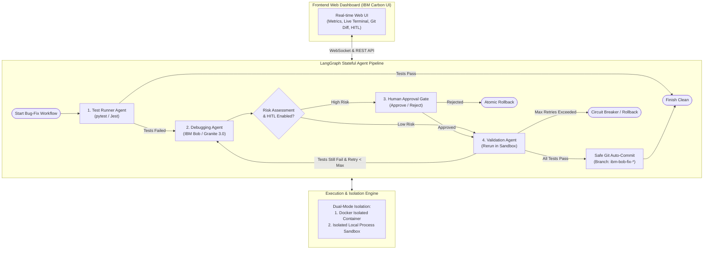

# 🤖 IBM Bob: AI-Powered Automated Bug-Fixing & Testing Agent

An autonomous multi-agent software engineering system powered by **IBM Bob** / **IBM Granite**, **LangGraph**, **GitPython**, and isolated container/sandbox execution.

The system autonomously runs unit tests, diagnoses stack traces, isolates defects, produces targeted code patches, executes iterative validation cycles, and applies automated version-controlled commits—with strict Human-in-the-Loop (HITL) safety boundaries and zero risk of unauthorized modifications to original repositories.

---

## 🏛️ System Architecture



---

## 🧠 The Three AI Agents

### 1. Test Runner Agent (`backend/agents/test_runner.py`)
- Automatically discovers and executes unit test suites using **pytest** (Python) and **Jest** (JavaScript).
- Executes within an isolated container or jailed sandbox subprocess with memory, CPU, and execution timeout constraints.
- Parses test stdout/stderr into structured test telemetry: passed count, failed count, line numbers, error types, and stack traces.

### 2. Debugging Agent (`backend/agents/debugger.py`)
- Analyzes stack traces, syntax trees, and source code context using **IBM Bob** and IBM Granite foundation models.
- Synthesizes root-cause diagnostics and classifies bug categories (e.g., `ArithmeticError`, `BoundaryError`, `LogicError`).
- Calculates an automated **Modification Risk Score** based on AST change complexity and blast radius.
- Produces clean unified diffs and conventional commit messages.
- Guards against infinite loops and cyclic repair attempts.

### 3. Validation Agent (`backend/agents/validator.py`)
- Applies candidate patches inside an isolated working tree branch created via **GitPython**.
- Re-executes the test runner to mathematically verify whether tests pass.
- If verified: stages files and automatically creates an authorized, traceable Git commit.
- If unverified: performs an atomic rollback (`git reset --hard` and `git clean -fd`), reverts the workspace, and feeds diagnostics back to the iterative loop.

---

## 🛡️ Security & Safe Git Isolation
- **No Direct Master Modifications**: The original repository branch is never touched directly. An isolated working branch (`ibm-bob-fix-<run_id>`) is automatically spun up.
- **Human-in-the-Loop (HITL)**: If a modification risk exceeds the configured threshold, execution safely pauses and renders an approval banner in the web dashboard for human review before any code changes are validated or merged.
- **Circuit Breakers**: Configurable max retry limits (default: 3) and duplicate patch detection protect against infinite agent execution loops.

---

## 📦 Directory Structure

```text
ibm-bob-bugfix-agent/
├── backend/
│   ├── agents/
│   │   ├── debugger.py         # Debugging Agent (IBM Bob reasoning)
│   │   ├── test_runner.py      # Test Runner Agent (pytest & Jest)
│   │   └── validator.py        # Validation Agent (verify & commit)
│   ├── executor/
│   │   └── docker_runner.py    # Docker & Isolated Sandbox execution engine
│   ├── llm/
│   │   └── bob_client.py       # IBM Bob / watsonx Granite client & heuristics
│   ├── git_manager.py          # GitPython repository manager (safe branches)
│   ├── graph.py                # LangGraph stateful workflow definition
│   └── main.py                 # FastAPI backend with WebSockets & REST APIs
├── frontend/
│   ├── index.html              # Modern Web Dashboard (IBM Carbon design)
│   ├── styles.css              # Carbon dark theme stylesheet
│   └── app.js                  # Real-time WebSocket controller & diff viewer
├── sample_repos/
│   ├── python_calculator/      # Python sample repo with intentional bugs
│   │   ├── calculator.py       # Buggy division, average, and factorial logic
│   │   └── tests/test_calculator.py # Comprehensive pytest test suite
│   └── js_string_utils/        # JavaScript sample repo with intentional bugs
│       ├── string_utils.js     # Buggy reverse, palindrome, truncate logic
│       └── tests/string_utils.test.js # Jest test suite
├── tests/
│   ├── test_agents.py          # End-to-end unit tests for the 3 agents
│   ├── test_git_manager.py     # Unit tests for Git isolation & rollback
│   └── test_runner_engine.py   # Unit tests for test execution engine
├── config.yaml                 # System configuration
├── requirements.txt            # Python dependencies
├── package.json                # Node/npm and Jest dependencies
├── Dockerfile                  # Docker build definition
├── docker-compose.yml          # Docker Compose orchestration
└── README.md                   # Project documentation
```

---

## 🚀 Quickstart & Installation

### Prerequisites
- Python 3.10+ (Tested on Python 3.14)
- Git
- Node.js & npm (for Jest testing)
- Docker Desktop (optional; isolated sandbox mode is used if Docker is absent)

### 1. Clone & Set Up Virtual Environment
```bash
cd ibm-bob-bugfix-agent
python -m venv venv

# Windows PowerShell:
.\venv\Scripts\Activate.ps1

# Linux/macOS:
source venv/bin/activate
```

### 2. Install Dependencies
```bash
pip install -r requirements.txt
npm install
```

### 3. Configure Environment Variables (Optional)
Create `.env` (optional; system runs out-of-the-box with IBM Bob heuristic intelligence if omitted):
```env
WATSONX_APIKEY=your_ibm_cloud_api_key
WATSONX_PROJECT_ID=your_watsonx_project_id
WATSONX_URL=https://us-south.ml.cloud.ibm.com
IBM_BOB_MODEL=ibm/granite-3-8b-instruct
```

### 4. Run Automated Test Suite
Verify that all agents and Git isolation engines pass:
```bash
pytest -v tests/
```

### 5. Launch the Web Application
```bash
python -m uvicorn backend.main:app --host 127.0.0.1 --port 8000 --reload
```

Open your browser to:
👉 **`http://127.0.0.1:8000`**

---

## 🎮 Demonstration Walkthrough

1. Open the dashboard at `http://127.0.0.1:8000`.
2. Notice the **Target Repository** dropdown (pre-selected to `Python Calculator`).
3. Click **"Run Bug-Fixing Agent"**:
   - **Step 1 (Test Runner)** runs pytest and captures 3 failing tests.
   - **Step 2 (IBM Bob Debugger)** performs root-cause analysis, identifies ZeroDivisionError, off-by-one divisor logic, and 0! base case, generating a unified diff.
   - **Step 3 (Human Approval Gate)** highlights the diff in green/red and prompts you to review the patch.
   - Click **"✓ Approve & Apply"**.
   - **Step 4 (Validation Agent)** applies the patch, reruns pytest in the sandbox, confirms 100% tests pass, and commits the fix to git!
4. Switch to **"JS String Utils"** to see Jest testing and automated repair for JavaScript codebases!
